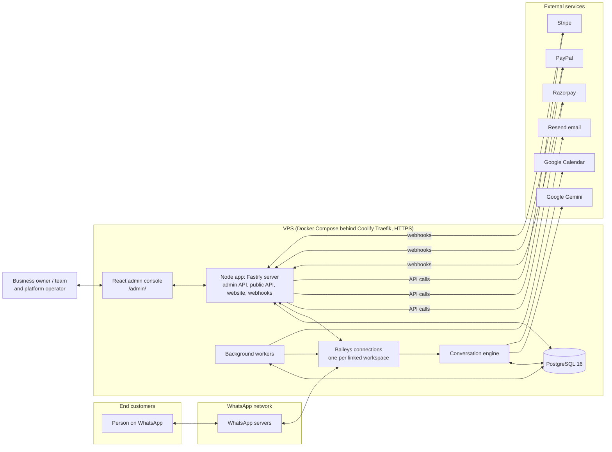
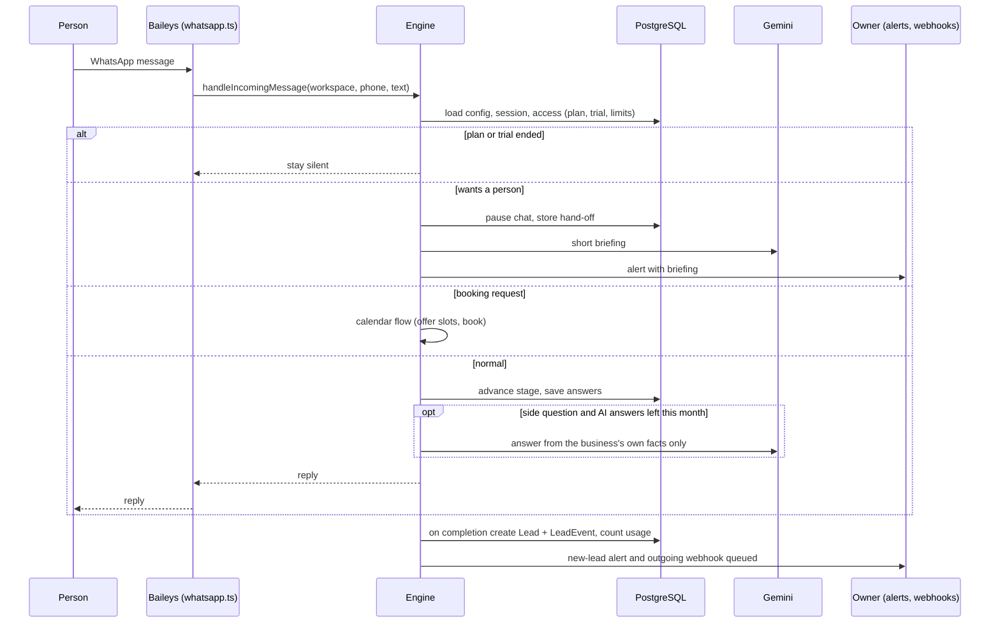
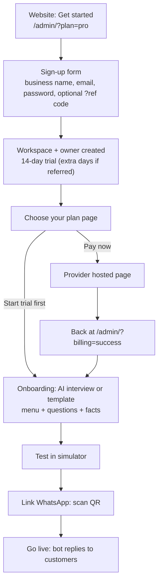
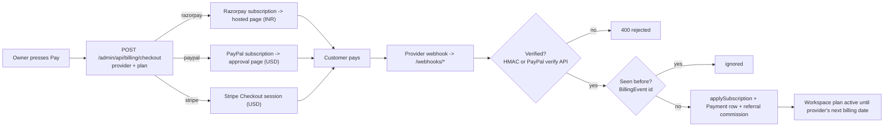
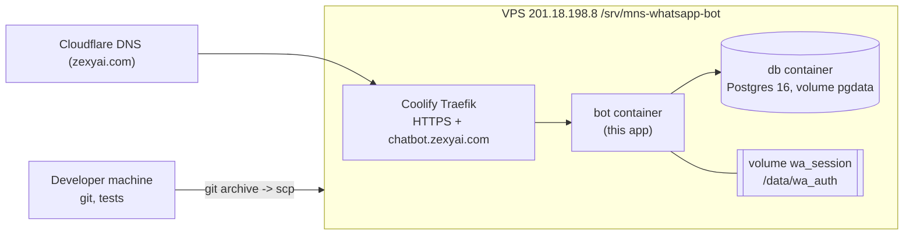

# System architecture

How the whole system fits together: what runs where, how data moves, how money and access are handled, and how to operate it. For day-to-day use see the [User Guide](USER_GUIDE.md) and the [Owner Guide](OWNER_GUIDE.md). Credentials are **not** in this repository: see the private `credentials.md` kept outside GitHub (it is git-ignored).

Contents: [1. What it is](#1-what-it-is) · [2. Big picture](#2-big-picture) · [3. Components](#3-components) · [4. Data model](#4-data-model) · [5. Flows](#5-flows) · [6. Billing and access](#6-billing-and-access) · [7. Security](#7-security) · [8. Deployment](#8-deployment) · [9. Configuration](#9-configuration) · [10. Operations runbook](#10-operations-runbook) · [11. Testing](#11-testing) · [12. Extending](#12-extending)

---

## 1. What it is

A multi-tenant SaaS. Each customer (a **workspace**, i.e. one business) links its own WhatsApp number by scanning a QR code (the same "Linked devices" mechanism WhatsApp Web uses, via the Baileys library). The bot then greets people who message that number, runs a guided question flow that turns them into **leads**, answers side questions with Gemini AI using only facts the business wrote down, books appointments in Google Calendar, hands over to a human on request, and gives the business a CRM, inbox, broadcasts, analytics, webhooks and a REST API.

It is **not** the official WhatsApp Business API and does not use Meta Cloud API. The platform operator ("Rajni" on the public site) runs one deployment; customers sign up themselves, get a 14-day trial of the one plan (Pro: ₹499/month in India, $19/month elsewhere) and pay online.

## 2. Big picture



One Node process hosts everything: HTTP server, the WhatsApp sessions, the conversation engine and the workers. PostgreSQL holds all business data. The WhatsApp login (auth files) lives on a Docker volume so restarts do not require re-scanning.

## 3. Components

| Component | Where | Responsibility |
|---|---|---|
| **Server** | `src/server.ts` | Starts Fastify, registers routes, starts WhatsApp and workers, `/health`, `/qr` operator page |
| **Admin API** | `src/admin.ts` | Everything the dashboard and operator tools call: login/sign-up, bot config, leads/CRM, inbox, broadcasts, billing, calendar, platform admin (`/admin/api/...`) and the payment webhooks (`/webhooks/stripe|razorpay|paypal`) |
| **Public API** | `src/publicApi.ts` | REST API for customers' own systems (`/api/v1/...`, secret API keys, needs an active plan) |
| **Website** | `src/site.ts` | Landing page, privacy, terms, refunds, contact, robots, sitemap, friendly 404. No scripts, strict CSP |
| **Admin console** | `web/` (React 18, Vite, Tailwind), served at `/admin/` | Owner dashboard (CRM, inbox, simulator, analytics, broadcasts, settings, billing) and the operator "Platform" screens |
| **WhatsApp layer** | `src/services/whatsapp.ts`, `transport.ts` | One Baileys connection per workspace, QR linking, reconnect on boot, slot cap (default 20 linked numbers), send/receive. `transport.ts` lets tests swap the sender |
| **Engine** | `src/services/engine.ts` | The conversation state machine (see 5.1) |
| **AI** | `src/services/gemini.ts` | Gemini calls: answers, onboarding interview, hand-off briefings. Model `gemini-3.8-flash` (`GEMINI_MODEL`). Thinking tokens count against the output cap, so caps stay at 1200 or more |
| **Bot config** | `src/services/botConfig.ts`, `templates.ts`, `onboarding.ts` | Per-workspace config cache, starter templates, AI-guided onboarding |
| **CRM and pipeline** | `crm.ts`, `pipeline.ts` | Leads, stages, owners, tags, notes, follow-ups, timeline events |
| **Hand-off** | `handoff.ts` | Detects "I want a person", pauses the chat, AI briefing, alert |
| **Calendar** | `calendar.ts` | Google OAuth, free-slot generation, booking, cancel, reminders |
| **Broadcasts** | `broadcast.ts` | Paced sending with window, daily cap, STOP handling |
| **Integrations** | `integrations.ts` | Signed, retried outgoing webhooks and API keys |
| **Language and follow-ups** | `language.ts`, `followups.ts` | Language answers and translation of bot messages; the customer follow-up worker |
| **Alerts and mail** | `alerts.ts`, `mailer.ts` | Lead alerts by WhatsApp and email (Resend, SMTP fallback) |
| **Billing** | `billing.ts`, `paypal.ts`, `razorpaySetup.ts`, `coupons.ts`, `affiliate.ts`, `plans.ts`, `usage.ts` | Plans and limits, checkout, webhooks, payments, redeem codes, referral commissions, usage counters |
| **Operator tools** | `platformStats.ts`, `settings.ts`, `src/cli/*` | Platform dashboard, global settings, CLIs (`adminUser`, `razorpaySetup`, `paypalSetup`) |
| **Auth** | `src/lib/auth.ts` | Password hashing, signed session cookies, roles |

**Background workers** (all inside the same process):

| Worker | Interval | Job |
|---|---|---|
| Broadcast | 4 s | Send the next due broadcast message (8–20 s pacing, 9:00–20:00 window, daily cap 150) |
| Webhook delivery | frequent | Deliver queued outgoing webhooks with retries |
| Follow-ups | 60 s | Alert owners when a lead's follow-up date is due |
| Customer follow-ups | 60 s | For businesses that switch it on: nudge customers who went quiet, 1, 3, 6 and 48 hours after their last message (see 5.9) |
| Appointment reminders | 60 s | Remind customers before a booking; expire stale slot offers |
| Renewals | 1 h | Payment-link renewal reminders (only in Razorpay link mode) |

## 4. Data model

PostgreSQL via Prisma (`prisma/schema.prisma`, migrations in `prisma/migrations`, applied automatically on container start).

```mermaid
erDiagram
  Workspace ||--o{ Service : has
  Service ||--o{ Question : has
  Workspace ||--o{ Session : has
  Session ||--o| Lead : produces
  Lead ||--o{ LeadEvent : timeline
  Workspace ||--o{ AdminUser : staff
  Workspace ||--o{ Stage : pipeline
  Workspace ||--o{ Broadcast : sends
  Broadcast ||--o{ BroadcastRecipient : to
  Workspace ||--o{ Webhook : outgoing
  Webhook ||--o{ WebhookDelivery : attempts
  Workspace ||--o{ ApiKey : keys
  Workspace ||--o{ Usage : monthly
  Workspace ||--o{ Payment : paid
  Workspace ||--o| CalendarConfig : calendar
  Workspace ||--o{ Appointment : bookings
  Workspace ||--o{ AffiliateCommission : earns
  Coupon ||--o{ CouponRedemption : used
```

| Model | Holds |
|---|---|
| `Workspace` | The business: profile, bot on/off, plan, plan status, trial end, current period end, billing provider and subscription id, hand-off settings, referral code and referrer, payout details |
| `Service`, `Question` | The bot's menu (up to 9 services) and questions (up to 12 each) |
| `Session` | One conversation per customer phone: stage, answers, pause flags, hand-off time and AI briefing, pending slot offer |
| `Lead` | A completed qualification: answers, stage, owner, tags, notes, follow-up date, source campaign |
| `LeadEvent` | Timeline (created, stage change, hand-off, booked...) |
| `AdminUser` | Staff logins with role `owner`, `admin`, `agent`; `isSuperAdmin` marks platform operators |
| `Stage` | The workspace's pipeline stages |
| `Broadcast`, `BroadcastRecipient` | Campaigns and per-recipient state |
| `Webhook`, `WebhookDelivery`, `WebhookLog`, `ApiKey` | Outgoing integrations and REST keys |
| `Usage` | Monthly counters: conversations, AI replies, broadcasts |
| `Payment`, `BillingEvent` | Payments recorded per provider reference; `BillingEvent` ids make webhook processing idempotent |
| `Coupon`, `CouponRedemption` | Redeem codes |
| `AffiliateCommission` | Referral commissions: pending, approved, paid, void |
| `CalendarConfig`, `Appointment` | Google Calendar link (refresh token encrypted) and bookings |
| `AuditLog`, `Setting` | Operator audit trail; global JSON settings (for example the referral programme) |

Session stages: `WELCOME → (AWAITING_LANGUAGE) → AWAITING_SERVICE_SELECTION → IN_QUESTIONNAIRE → COMPLETED`, plus `AGENT_TAKEOVER` while a person handles the chat. `AWAITING_LANGUAGE` is used only by workspaces with the language question switched on (`languageStep`); the answer is kept in `Session.language`. Each `Service` can carry its own `closingMessage`, and a workspace can switch on `followUpsEnabled`.

## 5. Flows

### 5.1 A customer messages a business



Rules worth knowing: customers can type `menu` to restart and `STOP` to leave broadcast lists; the owner can send `!pause` / `!resume` from their phone; simulator conversations never book real appointments; unlinked or over-limit workspaces never crash the engine, they fall back to fixed replies or silence.

### 5.2 A business signs up and goes live



Sign-up can be closed with `SIGNUP_ENABLED=0`. A referral link (`?ref=CODE`) credits the referrer a commission on payments when the programme is on.

### 5.3 Paying



Nothing is switched on from the browser return page: **only a verified webhook turns a plan on**. See section 6 for each provider.

### 5.4 Appointment booking

Owner connects Google Calendar (OAuth, scope for events and free/busy). In chat the customer says they want to book → the bot offers up to a few real free times (working days and hours, appointment length, buffer, minimum notice, max 2 per day) → the customer picks one → the event is created and a booking row saved under a per-workspace lock (two people can never take the same slot) → reminders go out before the start → customers may cancel by message. Slot offers expire after 30 minutes.

### 5.5 Human hand-off

A regular-expression check finds requests for a person (not "call me", which is too common). The session is paused (`AGENT_TAKEOVER`), the customer is told someone will reply, Gemini writes a short briefing from the chat and answers, and the owner is alerted by WhatsApp and/or email. The owner replies from the inbox or their phone; resuming hands control back to the bot.

### 5.6 Broadcasts

Owner picks recipients and writes a message (with name personalisation). The worker sends one message at a time with 8–20 s random spacing, only within 9:00–20:00 (workspace time zone), up to the daily cap, skipping anyone who sent STOP. Monthly broadcast counts are limited by the plan.

### 5.7 Integrations

Events (new lead, stage change...) are stored and delivered to each configured webhook URL as signed JSON, retried with backoff. Webhook targets must be public addresses (private ranges are refused). The REST API (`/api/v1`) lets customer systems read leads and move them between stages with a secret key.

### 5.9 Language question, closing messages and follow-ups

Three optional per-business features (Dashboard → Bot & Settings), all off unless the business turns them on:

- **Language first** (`languageStep`): the first reply asks which language the customer prefers (the text is `languageWelcome`). The answer ("1", "English", "Hindi", "Tamil"...) is stored on the session; from then on every fixed bot message (menu, questions, closing message, reminders) is translated by Gemini into that language, cached, and falls back to the English original if translation is unavailable or the plan's AI allowance is used up. AI answers to side questions are written in that language directly. English chats never call the translator. `MENU` shows the menu again without asking the language again.
- **Closing message per service** (`Service.closingMessage`): shown when a customer finishes that service's questions, so each service can point to its own link (jobs website, product site, consultation). Empty means the general thank-you.
- **Customer follow-ups** (`followUpsEnabled`): the follow-up worker (`followups.ts`) sends at most one nudge per quiet customer per pass, the latest one that is due at 1, 3, 6 or 48 hours after the customer's last message. A customer is skipped when they sent STOP, a person has taken over or the chat was handed off, the lead's stage is Won, Lost or Booked, the plan lapsed, WhatsApp is not connected, it is outside 9:00 to 20:00 in the business's time zone, or the chat has been quiet for more than three days (so switching it on never wakes old chats). Any reply from the customer resets the sequence.

Price or fee questions typed without a question mark (for example "DHA fees") are answered by the AI like any other question.

### 5.8 Referral and redeem codes

Referral: each workspace has a code; a business that signs up with it records `referredById`; every recorded payment may create a commission (default 20% for 12 payments, off by default), reviewed in the operator's Affiliates screen. Redeem codes grant a plan or a trial extension for a number of days; a code cannot overwrite a plan that is currently running.

## 6. Billing and access

**One plan, Pro** (`src/plans.ts`): ₹499 or $19 a month, 1,500 conversations, 2,000 AI answers, 5 team members and 1,000 broadcasts a month, integrations included. A trial gets the same. Older plan ids (`starter`, `growth`, `scale`) are treated as Pro. Counters reset every calendar month; at a limit the bot stops starting new chats or AI answers but existing chats continue.

**Access** is one pure function, `accessState(workspace)`:

| Plan status | Bot may reply? |
|---|---|
| `trialing` | until `trialEndsAt` |
| `active` | until `currentPeriodEnd` + 3 days' grace |
| `past_due` | until `currentPeriodEnd` + 3 days' grace |
| `canceled` | until `currentPeriodEnd`, then no |
| plan `internal` | always, no limits (the operator's own business) |

**Providers**

| Provider | Currency | Mode | Webhook | Verification |
|---|---|---|---|---|
| Razorpay | INR | Subscriptions (default) or payment links (`RAZORPAY_MODE=link`) | `/webhooks/razorpay` | HMAC SHA-256 of the raw body with `RAZORPAY_WEBHOOK_SECRET` |
| PayPal | USD | Subscriptions (billing plans) | `/webhooks/paypal` | PayPal's `verify-webhook-signature` API with `PAYPAL_WEBHOOK_ID` |
| Stripe | USD | Checkout subscriptions + billing portal | `/webhooks/stripe` | `Stripe-Signature` HMAC with timestamp tolerance |

PayPal events used: `BILLING.SUBSCRIPTION.ACTIVATED` / `RE-ACTIVATED` (plan on, period end = PayPal's next billing time), `PAYMENT.SALE.COMPLETED` (record payment, read the subscription for the next billing date), `SUSPENDED` / `PAYMENT.FAILED` (past due), `CANCELLED` / `EXPIRED` (keep paid-up date, then stop). Events for an abandoned earlier checkout are ignored so a never-paid cancel cannot end a trial. A card-only guest checkout is **not** available for PayPal subscriptions outside the US and Canada: buyers need a PayPal account. Cards in dollars need Stripe, and rupees need Razorpay.

A provider only shows as available when its keys, webhook secret/id and plan ids are all set. **Platform admin → Settings → Payments setup** shows a checklist and can test each provider live.

## 7. Security

- **Passwords** hashed; sessions are signed cookies; roles `owner`, `admin`, `agent`; operator tools need `isSuperAdmin`.
- **Tenant isolation**: every query is scoped by `workspaceId`; the engine, workers and API resolve the workspace first.
- **Webhooks** (payments) are authenticated by signature over the raw body and processed once (`BillingEvent`). Outgoing webhooks are signed.
- **Secrets** live only in the server `.env` and environment. Provider keys are never sent to the browser (the setup page returns only ok/not-ok). Google refresh tokens are AES-256-GCM encrypted.
- **Website** serves no scripts and a strict Content-Security-Policy. User-controlled values on public pages are HTML-escaped.
- **Abuse limits**: login and redeem-code attempts are throttled; broadcasts are paced and capped; outgoing webhooks refuse private addresses.
- **WhatsApp risk**: this is not the official API; the product is upfront about it on the site and terms.
- Rotate any key that was ever pasted into chat or email.

## 8. Deployment



- Docker Compose project `mnsbot`: files `docker-compose.yml` + `docker-compose.vps.yml` (Traefik labels, no published ports). The image builds the React console and the TypeScript server. On start the container runs `prisma migrate deploy` and then the server.
- The server also hosts Coolify and other sites, so never touch other containers or the Traefik setup.
- Volumes: `pgdata` (database) and `wa_session` (WhatsApp login).

**Deploy steps** (from the project folder, in Git Bash; do not pipe `git archive` through PowerShell):

```
# 1. backup
ssh -i ~/.ssh/id_ed25519_mns_bot root@201.18.198.8 "cd /srv/mns-whatsapp-bot && docker compose -p mnsbot -f docker-compose.yml -f docker-compose.vps.yml exec -T db pg_dump -U postgres -Fc mns_bot > backups/pre-<name>.dump"
# 2. ship and rebuild
git archive -o bot.tar HEAD
scp -i ~/.ssh/id_ed25519_mns_bot bot.tar root@201.18.198.8:/tmp/bot.tar
ssh -i ~/.ssh/id_ed25519_mns_bot root@201.18.198.8 "cd /srv/mns-whatsapp-bot && tar -x -C /srv/mns-whatsapp-bot --exclude=.env -f /tmp/bot.tar && docker compose -p mnsbot -f docker-compose.yml -f docker-compose.vps.yml up -d --build bot"
# 3. verify
curl -s https://chatbot.zexyai.com/health
```

`--exclude=.env` keeps the server's secrets. After a restart WhatsApp reconnects by itself within about a minute if the saved login is intact; if `/data/wa_auth/<workspace>` is empty the number was unlinked and must be scanned again.

## 9. Configuration

All settings are environment variables in the server `.env` (full annotated list in `.env.example`).

| Group | Variables |
|---|---|
| Core | `DATABASE_URL` (set by Compose), `POSTGRES_PASSWORD`, `ADMIN_TOKEN` (operator `/qr` page), `SESSION_SECRET`, `PUBLIC_URL`, `BOT_DOMAIN`, `BOT_DOMAIN_ALT`, `WA_SESSION_PATH`, `SIGNUP_ENABLED`, `PRODUCT_NAME`, `MAX_WHATSAPP_NUMBERS` |
| AI | `GEMINI_API_KEY`, `GEMINI_MODEL` |
| Email | `RESEND_API_KEY`, `MAIL_FROM` (SMTP fallback: `SMTP_*`) |
| Google Calendar | `GOOGLE_CLIENT_ID`, `GOOGLE_CLIENT_SECRET` (redirect `<PUBLIC_URL>/admin/api/calendar/callback`) |
| Razorpay | `RAZORPAY_KEY_ID`, `RAZORPAY_KEY_SECRET`, `RAZORPAY_WEBHOOK_SECRET`, `RAZORPAY_PLAN_PRO`, `RAZORPAY_MODE` |
| PayPal | `PAYPAL_MODE` (`live`/`sandbox`), `PAYPAL_CLIENT_ID`, `PAYPAL_CLIENT_SECRET`, `PAYPAL_WEBHOOK_ID`, `PAYPAL_PLAN_PRO` |
| Stripe | `STRIPE_SECRET_KEY`, `STRIPE_WEBHOOK_SECRET`, `STRIPE_PRICE_PRO` |
| Website | `OPERATOR_NAME` (default Rajni), `SUPPORT_EMAIL`, `SUPPORT_PHONE`, `BUSINESS_ADDRESS`, `SUPPORT_HOURS`, `LEGAL_JURISDICTION` |

Prices and limits are code, not environment: edit `src/plans.ts` and redeploy, then create matching plans at each provider.

## 10. Operations runbook

| Task | How |
|---|---|
| Health | `GET /health` → `{"ok":true,"whatsapp":"ready",...}` (`off` means no linked/connected number) |
| Logs | `ssh ... "docker logs --tail 100 mnsbot-bot-1"` |
| Create or reset an admin | `docker exec mnsbot-bot-1 node dist/cli/adminUser.js <email> <password (10+ chars)>` |
| Re-link WhatsApp | Dashboard → Bot & Settings → WhatsApp → Connect, or `/qr?token=<ADMIN_TOKEN>` for the default workspace |
| Apply the operator's own business setup (menu, questions, AI notes) | `docker exec mnsbot-bot-1 node dist/cli/ownBusiness.js` (replaces the default workspace's menu and notes with `src/ownBusiness.ts`; safe to repeat) |
| Create PayPal plan + webhook | `docker exec mnsbot-bot-1 node dist/cli/paypalSetup.js` (safe to repeat) |
| Create the Razorpay plan | `docker exec mnsbot-bot-1 node dist/cli/razorpaySetup.js` (run once only) |
| Check payment setup | Platform admin → Settings → Payments setup |
| Backup | `pg_dump -Fc` as in section 8; keep dumps in `/srv/mns-whatsapp-bot/backups/` |
| Restore | `pg_restore` into the `db` container after stopping the bot |
| Open or close sign-up | `SIGNUP_ENABLED=1` or `0` in `.env`, then `docker compose ... up -d bot` |
| Change a secret | Edit `.env`, then `docker compose -p mnsbot -f docker-compose.yml -f docker-compose.vps.yml up -d bot` (recreates the container with the new environment) |

Common problems:

| Symptom | Likely cause |
|---|---|
| `whatsapp: off` after restart and no session files | The number was unlinked from the phone or logged out: scan the QR again |
| Payment taken but plan not on | Webhook not arriving or wrong secret/id: check the provider's webhook delivery log and the Payments setup page |
| PayPal page asks for a PayPal login | Expected outside the US/Canada for subscriptions; use Stripe for cards |
| AI answers cut off | Gemini thinking tokens use the output cap; keep caps at 1200 or more |
| Cloudflare 522 on a new subdomain | The Cloudflare DNS record must exist in the zexyai.com zone |

## 11. Testing

All tests are scripts in `scripts/` run with `npx tsx scripts/<name>.ts` against a local PostgreSQL (`DATABASE_URL`). Payment providers, Google and WhatsApp are replaced with fakes, so tests never touch live accounts.

| Script | Covers |
|---|---|
| `e2e.ts` | Conversation engine, hand-off, limits, simulator |
| `mns-flow-test.ts` | The operator's own business setup: language question, translated menu and questions, closing links, price questions, follow-ups |
| `admin-test.ts` | Admin API, roles, billing with Stripe/Razorpay events, coupons, platform tools |
| `broadcast-test.ts` | Pacing, windows, caps, STOP |
| `integration-test.ts` | Webhooks and REST API |
| `calendar-test.ts` | Slots, booking, cancel, reminders |
| `razorpay-subscription-test.ts`, `razorpay-link-test.ts` | Razorpay subscription and link modes |
| `paypal-test.ts` | PayPal plan creation, checkout, every webhook event, cancel, checks |
| `site-test.ts` | Public website and legal pages |
| `smoke-test.ts <dir>` | Real browser walkthrough of operator and owner screens, phone-width layout, writes screenshots |
| `site-shots.ts <dir>` | Screenshots of the public site |

`npx tsc --noEmit -p .` checks the server types; `cd web && npx tsc --noEmit` the console.

## 12. Extending

- **New plan or price**: edit `src/plans.ts`; create the matching provider plans; update env ids. `PlanDef.id` is a single literal today, so widen it when adding plans.
- **New payment provider**: add to `Provider` in `billing.ts`, a checkout branch in `startCheckout`, a webhook handler that verifies, dedupes with `BillingEvent`, calls `applySubscription` and `recordPayment`, register the route in `admin.ts`, add a setup check and a button in `Billing.tsx`.
- **New conversation behaviour**: `engine.ts` is the single entry point; add checks in order (access, hand-off, booking, reset commands, stage logic).
- **Ideas not built**: knowledge base from PDFs/URLs, contact segments, team inbox assignment, website chat widget.
